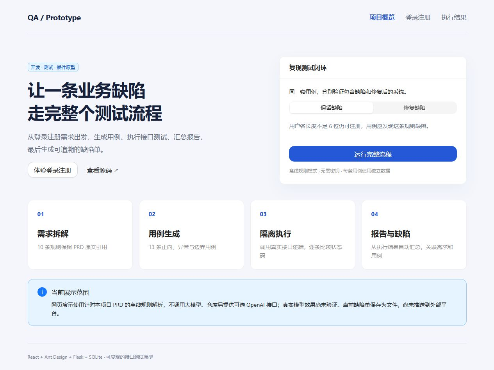

# 自动化测试全流程原型

[](https://github.com/Keon759/test_demo/actions/workflows/verify.yml)

**React + Flask 登录注册沙盒，配套可复现的需求拆解、接口执行、报告与缺陷单生成流程。**

项目从一个具体问题开始：PRD 要求用户名至少 6 位，系统刻意遗漏这条校验。测试是否能够发现问题、关联需求并留下可复现的缺陷记录？



无需 API 密钥即可运行离线演示。可选 OpenAI 接口使用结构化输出生成测试计划；执行器只处理限定接口的 JSON 测试数据，不执行模型生成的代码。

## 先看结果

以下是 2026-10-13 后续完善版本在 Windows 上实际执行的离线结果，修复模式回放同一份测试计划：

| 模式 | 需求 | 用例 | 通过 | 失败 | 执行错误 | 本地缺陷单 |
| --- | --- | --- | --- | --- | --- | --- |
| 保留用户名长度缺陷 | 10 | 13 | 12 | 1 | 0 | 1 |
| 启用修复 | 10 | 13 | 13 | 0 | 0 | 0 |

- [包含缺陷：自动生成报告](examples/offline-buggy/report.md) · [完整执行记录](examples/offline-buggy/execution.json) · [缺陷单](examples/offline-buggy/bugs.md)
- [修复后：回放报告](examples/offline-fixed/report.md) · [完整执行记录](examples/offline-fixed/execution.json)
- [测试计划](examples/offline-buggy/plan.json) · [PRD](docs/01-PRD.md) · [实际架构与边界](docs/07-插件原型架构方案.md)
- [网页执行结果截图](docs/images/results.jpg)
- [完整验证记录](docs/09-验证记录.md)

统计由执行记录自动计算。这里的失败用例用于展示缺陷发现，与验证程序正确性的 pytest 测试是两套不同指标。

## 原始成果与后续完善

2026 年 7 月的原始版本包含登录注册 Demo、一个预埋业务规则缺陷、PRD、需求分析、测试资产与插件架构方案。原型中的 Bug 单用于模拟自动提 Bug 流程。

2026-10-13 的后续完善新增可运行的流程编排、自动生成报告与本地缺陷单、修复回放、演示面板、可选模型接口和持续集成。新增功能属于后续工程完善，不能据此回溯声称原始版本已经实现全部 AI 能力。[变更记录](CHANGELOG.md)

| 能力 | 当前状态 |
| --- | --- |
| React / Ant Design 登录注册界面 | 已实现，实际使用 Ant Design、Axios、React Router |
| Flask / SQLite 注册登录接口 | 已实现，默认保留一个预埋缺陷；支持修复模式 |
| PRD → 需求与测试计划 | 离线规则解析已验证；仅支持本项目规定格式的登录注册 PRD |
| 大模型 PRD 解析与用例生成 | 已编写 Prompt、JSON Schema 和 OpenAI Responses API 接入；仅验证模拟响应，尚未实测真实 API |
| 接口执行与报告生成 | 已实现；每条用例使用独立数据库，执行真实 Flask 接口处理逻辑 |
| 自动生成缺陷单 | 已实现本地 JSON/Markdown 文件生成，按需求与失败特征去重 |
| 向 GitHub Issues / Jira 推送 | 未实现，保留为后续扩展 |
| 浏览器自动化执行器、多轮 Agent | 未实现；本次浏览器人工复现与接口执行器分别说明 |

## 五分钟复现

环境：Python 3.12+，Node.js 20.19+ 或 22.12+，npm。所有命令从仓库根目录开始。

### 1. 安装后端依赖

Windows PowerShell：

```powershell
python -m venv backend/.venv
.\backend\.venv\Scripts\python.exe -m pip install -r backend/requirements.txt
```

macOS / Linux：

```bash
python3 -m venv backend/.venv
backend/.venv/bin/python -m pip install -r backend/requirements.txt
```

下面的 `python` 指已安装依赖的解释器；Windows 可替换为 `.\backend\.venv\Scripts\python.exe`，macOS / Linux 可替换为 `backend/.venv/bin/python`。

### 2. 一键复现缺陷与回归

```bash
python -m backend.run_pipeline --output artifacts/buggy
python -m backend.run_pipeline --fixed --plan artifacts/buggy/plan.json --output artifacts/fixed --fail-on-defect
```

打开 `artifacts/buggy/report.md` 和 `bugs.md`，再对比 `artifacts/fixed/report.md`。

输出包括需求、测试用例、执行记录、报告、缺陷单五类资产，以及 PRD 快照、完整计划和运行元数据。默认返回 0 表示流程执行成功；`--fail-on-defect` 使业务用例失败也返回 1；配置或生成错误返回 2。

### 3. 打开交互演示

```bash
npm --prefix frontend ci
python scripts/start_demo.py
```

访问 **http://127.0.0.1:5173/**。首页可切换缺陷/修复模式，运行流程、查看逐条结果并下载交付物。登录注册页用于单独体验业务系统。

Windows 也可运行 `run-demo.ps1` 或双击 `run-demo.bat`，完成依赖安装并启动服务。Ctrl+C 停止服务。

分开启动时：

```bash
python -m backend.app
npm --prefix frontend run dev
```

后端默认绑定 `127.0.0.1:5000`。若端口已占用，启动器会提示，不会结束已有程序。沙盒登录只验证账号密码，不建立会话，不作为生产认证系统。

## 可选：真实模型生成计划

离线演示不会发起模型请求。选择 `--provider openai` 才会调用真实 API，需要自己的 API 密钥和支持结构化输出的模型，可能产生 API 费用。

Windows 推荐使用本机验证入口，运行时输入可用的模型 ID 和密钥。模型 ID 留空默认采用官方入门示例的 `gpt-6-astra`；账户访问权限以实际 API 返回为准。密钥输入隐藏，仅放入当前进程环境，结束后恢复；不会写入文件或发送到 GitHub：

```powershell
.\run-model-validation.ps1
```

脚本只调用一次模型生成计划，再用该计划执行缺陷模式与修复回归，不自动重试付费请求。结果保存在新的 `artifacts/model-时间戳/` 目录，包含调用编号、模型、Token 使用、计划指纹、两次执行记录和验证结论。它会检查是否真的检出了用户名长度缺陷，而不是只看用例通过率。现有证据目录不会被覆盖。

尚无密钥时，先在 [OpenAI API 控制台](https://platform.openai.com/api-keys) 创建；按账户要求配置 API 计费。密钥不应发送到聊天、前端代码或仓库。[官方入门说明](https://developers.openai.com/api/docs/quickstart)

已通过环境变量配置时，也可使用：

```powershell
.\backend\.venv\Scripts\python.exe scripts/validate_model.py
```

程序使用 [OpenAI Responses API 结构化输出](https://developers.openai.com/api/docs/guides/structured-outputs?api-mode=responses)，一次调用返回需求与用例计划；本地校验结构、需求原文引用、用例关联及覆盖后再执行。未配置密钥、模型拒绝、响应不完整或计划无效时会明确停止，不会悄悄切换离线模式。

真实模型的需求理解与用例质量尚未实测，模型生成的预期结果仍需人工审核。当前 Prompt / Schema 是工程接入，不涉及模型训练或微调。

## 验证与目录

```bash
python -m pytest -q
npm --prefix frontend run build
```

持续集成会在 Windows / Ubuntu 验证后端，并构建前端，保留两种模式的执行资产。[查看实际运行状态](https://github.com/Keon759/test_demo/actions)

```text
backend/       业务沙盒、计划生成、执行与报告管道、自动检查
frontend/      React / Ant Design 演示与结果面板
prompts/       真实模型模式使用的 Prompt
docs/          PRD、需求与测试说明、架构、简历描述建议
examples/      本次实际运行产出的离线样例
scripts/       本地双服务启动器
artifacts/     自己运行的结果（不提交到 Git）
```
