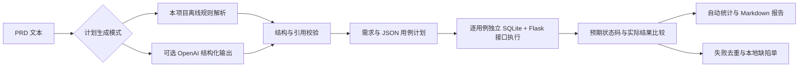

# 自动化测试插件原型：实际架构与扩展

此页描述 2026-10-13 后续完善后的实现。原始版本以沙盒、测试资产和设计方案为主。

## 代码入口

| 模块 | 文件 | 输入 → 输出 |
| --- | --- | --- |
| 业务沙盒 | `backend/app.py` | JSON 凭据 → 注册/登录响应；缺陷开关 |
| 计划生成与校验 | `backend/planner.py` | PRD → 引用原文的需求与受限用例 |
| Prompt | `prompts/generate-plan.txt` | 模型任务约束、接口约定、前置数据规则 |
| 执行编排 | `backend/pipeline.py` | 计划 → 执行记录、统计、去重缺陷与文件 |
| 命令入口 | `backend/run_pipeline.py` | 模式/计划/目录 → 可保存、可回放的交付物 |
| 页面演示 | `frontend/src/App.jsx` | 模式选择 → 真实执行结果与文件下载 |

## 计划生成边界

离线模式不是 AI：它识别当前 PRD 中注册/登录规则和用户名、密码最小长度，利用固定规则模板生成边界用例；不支持任意行业 PRD。变更最小长度会影响测试数据，业务实现仍使用既定 6 位规则，因此变化可能发现新的差异。

OpenAI 模式以 PRD 为输入，使用 JSON Schema 输出需求与用例。模型不直接执行接口，不决定外部网址，不生成可执行 Python。每条需求必须引用 PRD 原文，所有用例必须关联已有需求，所有需求至少有一条用例。结构有效不等于业务语义正确，生成预期仍需审核。

真实 API 尚未实测；自动检查覆盖模拟有效输出、拒绝、不完整响应、错误 JSON、未配置环境以及无效计划拒绝。没有编写模型训练、微调或多轮 Agent。

## 执行与缺陷

Flask test client 调用真实后端处理函数，没有真实 HTTP 传输，也没有浏览器执行器。每条用例使用新数据库，前置注册数据失败计为执行错误，不冒充业务缺陷。正常用例比较 HTTP 状态码；认证密码散列与中文响应另有自动检查。

失败记录按需求、接口、预期/实际状态码去重，生成包含原文引用、前置条件、数据、实际响应的 JSON/Markdown 缺陷单。交付方式为本地文件，不向 GitHub Issues / Jira 自动提交。

缺陷模式遗漏用户名长度校验；修复模式启用该规则。回归使用已保存的同一份计划，避免重新生成用例改变验证口径。

## 后续方向

- 配置真实模型并保留脱敏模型运行证据，评估需求覆盖与误报。
- 增加实际 HTTP / OpenAPI 执行器及响应体断言。
- 接入 Playwright 页面自动化与页面级证据。
- 经显式配置后接入外部 Bug 平台，处理幂等、权限及重试。
- 增加更广泛的业务规则类型和需求变更回归。
